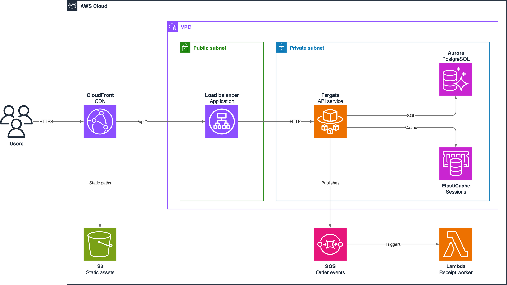
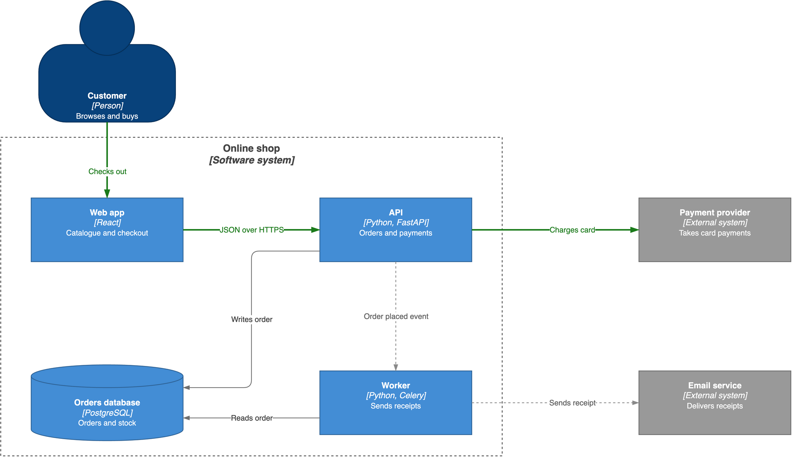
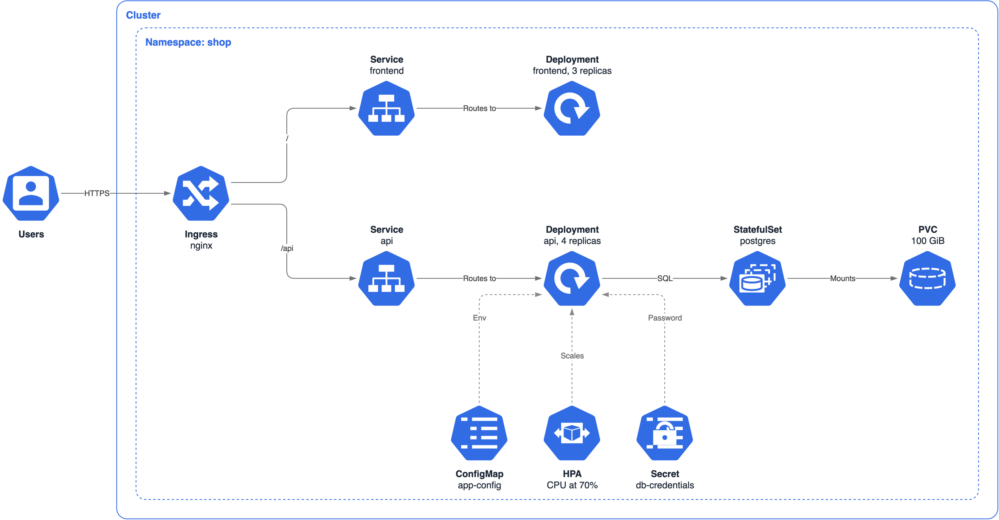
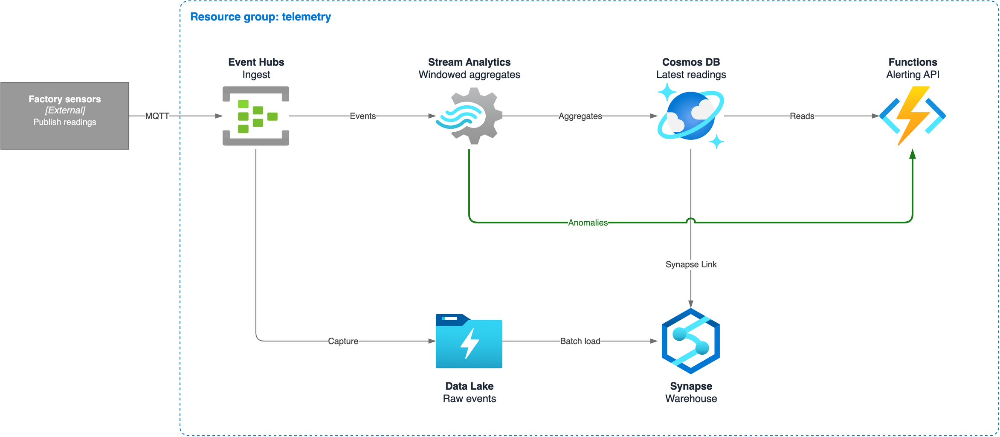
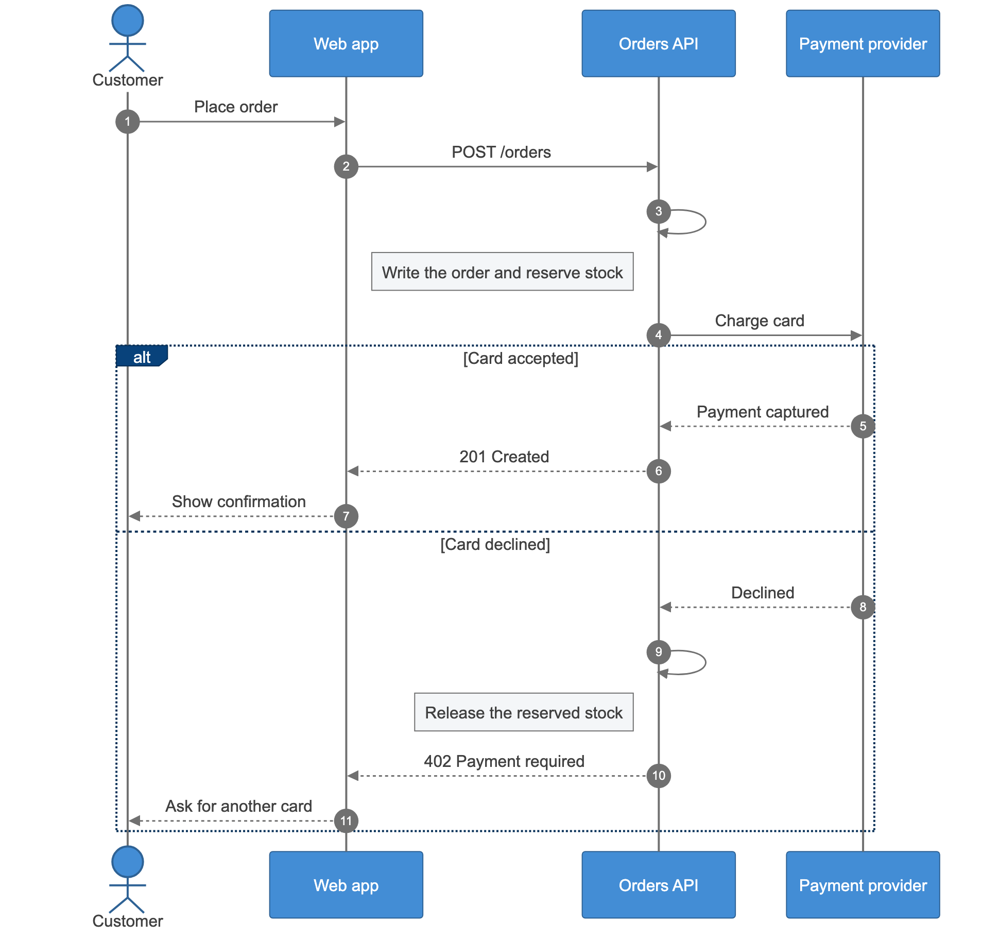
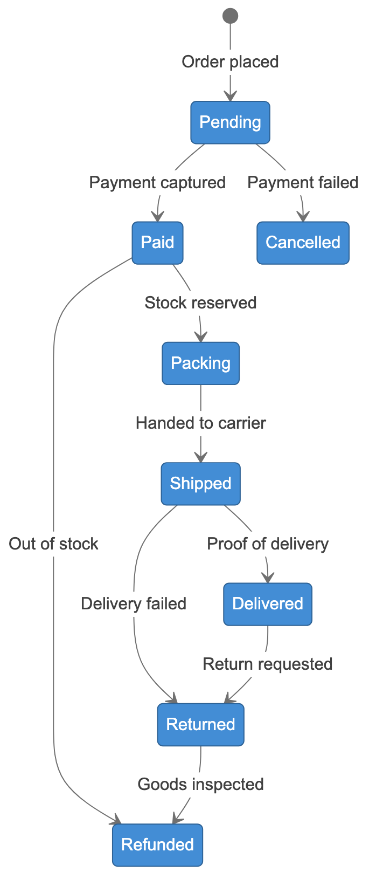
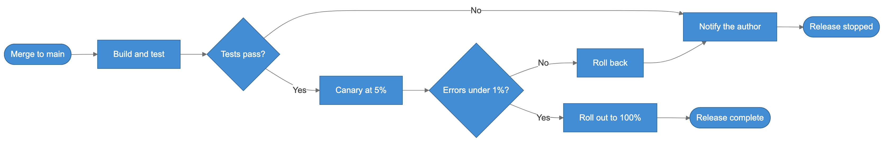
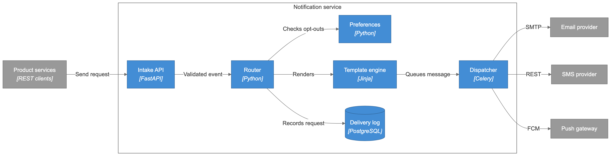
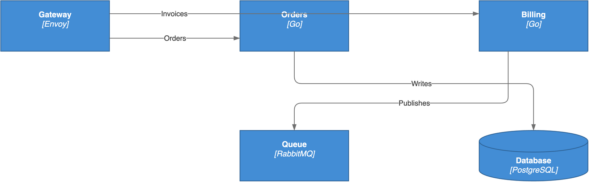
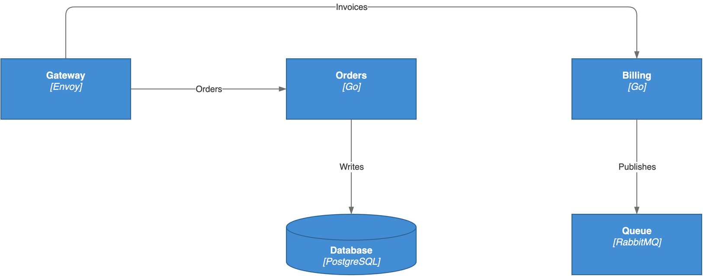

# diagram-lint

[](https://github.com/xavier-thomas/diagram-lint/actions/workflows/ci.yml)
[](https://sonarcloud.io/summary/overall?id=xavier-thomas_diagram-lint)
[](https://xavier-thomas.github.io/diagram-lint/)
[](https://sonarcloud.io/summary/overall?id=xavier-thomas_diagram-lint)
[](https://github.com/xavier-thomas/diagram-lint/releases/latest)
[](LICENSE)
[](https://skills.sh/xavier-thomas/diagram-lint)

Architecture diagrams as code, checked before anyone has to read them.

An agent skill that writes draw.io and Mermaid diagrams into version control, then proves
that no line runs through a box or crosses another line without a jump.



> Draw our web app on AWS: CloudFront in front of S3 and a load balancer. Fargate, Aurora
> and ElastiCache sit in a private subnet, and orders go through SQS to a Lambda worker.

```bash
npx skills add xavier-thomas/diagram-lint
```

Works with any agent that supports [skills](https://agentskills.io). In the Claude apps,
upload `diagram-lint.zip` from
[Releases](https://github.com/xavier-thomas/diagram-lint/releases/latest) as a skill.

## What you get

- **Source you can review.** Each diagram is a Python generator or a `.mmd` file, so a
  change shows up as a readable diff. The `.drawio` output still opens in draw.io.
- **Routes that are proven.** draw.io edges are pinned to exact coordinates, and
  `check_layout.py` verifies them. It reports any route it cannot predict as `UNVERIFIED`,
  never as clean.
- **One look across toolchains.** draw.io and Mermaid share a C4 palette, and cloud
  diagrams use draw.io's AWS, Azure and Kubernetes icon stencils.
- **Nothing to install.** The checks need only Python 3.12 and its standard library.

## Examples

Every image below is rendered from the source in [`examples/diagrams`](examples/diagrams).
The quotes show the kind of request each one answers. An agent's result will differ in its
details, but must pass the same checks.

### draw.io: pinned layout, cloud icons

<table>
  <tr>
    <td valign="top">
      
      <p><b>C4 container diagram</b>, with a highlighted path and dashed async links</p>
      <blockquote>Draw a C4 container diagram of our online shop. Highlight the checkout path and dash anything asynchronous.</blockquote>
    </td>
  </tr>
  <tr>
    <td valign="top">
      
      <p><b>Kubernetes</b>, with nested cluster and namespace boundaries</p>
      <blockquote>Draw our shop namespace on Kubernetes: nginx ingress to a frontend and an API, Postgres in a StatefulSet, and the API's ConfigMap, Secret and HPA.</blockquote>
    </td>
  </tr>
  <tr>
    <td valign="top">
      
      <p><b>Azure</b>, with a line jump at the one crossing that was asked for</p>
      <blockquote>Draw our telemetry pipeline on Azure. Send anomalies straight from Stream Analytics to Functions in green, and use a line jump where they cross the Synapse Link.</blockquote>
    </td>
  </tr>
</table>

### Mermaid: quick to write, laid out for you

<table>
  <tr>
    <td width="60%" valign="top">
      
      <p><b>Sequence</b>, with numbered steps and branches</p>
      <blockquote>Draw the checkout sequence, including what happens when the card is declined.</blockquote>
    </td>
    <td width="40%" valign="top">
      
      <p><b>State</b></p>
      <blockquote>Draw the states an order moves through.</blockquote>
    </td>
  </tr>
  <tr>
    <td colspan="2" valign="top">
      
      <p><b>Logic flow</b></p>
      <blockquote>Draw our release flow: tests, then a canary at 5%, then a full rollout or a rollback.</blockquote>
    </td>
  </tr>
  <tr>
    <td colspan="2" valign="top">
      
      <p><b>Component</b></p>
      <blockquote>Draw the components of our notification service and the providers it sends through.</blockquote>
    </td>
  </tr>
</table>

## See the check at work

These two diagrams have the same content. The source of the first looks fine in a code
review, but its render does not, and the check says why:



```text
$ python3 scripts/check_layout.py lint-before.drawio
lint-before.drawio: 5 nodes, 4 edges, 4 verified, 0 unverifiable
  OVERLAP     n8 'Invoices' is drawn over node n3
  OVERLAP     n9 'Writes' crosses n10 'Publishes'
```

The agent has to fix the layout before it can finish. A second script then proves that the
fix did not change what the diagram says:



```text
$ python3 scripts/check_layout.py lint-after.drawio
lint-after.drawio: 5 nodes, 4 edges, 4 verified, 0 unverifiable
  clean: no line over a node, no crossing, no line drawn on another

$ python3 scripts/content_diff.py lint-before.drawio lint-after.drawio
same content: 5 nodes, 4 edges, 0 boxes
```

## How it works

The skill picks a toolchain by diagram type:

| Diagram | Source | Layout |
|---------|--------|--------|
| Topology, or anything with cloud icons or logos | Python script that generates a `.drawio` file | Pinned to exact coordinates |
| Sequence, logic flow or component | `.mmd` file | Chosen by Mermaid |

Then it checks what it made:

| Check | Applies to | Fails on |
|-------|------------|----------|
| `check_layout.py` | draw.io | A line through a node, a crossing without a valid line jump, two lines drawn on top of each other, an anchor outside its node, or a route it cannot predict |
| `content_diff.py` | draw.io | Node labels, edges or boundary contents that changed in a re-layout |
| `check_mermaid.py` | Mermaid | A self-message that carries text, which would sit on its step number and lifeline |
| Render inspection | Both | Anything on the [checklist](skills/diagram-lint/SKILL.md#inspect-the-render), such as labels on captions, blank icons and lines that touch |

The scripts cannot see a render, so the agent must also open the real `.png` and work
through the checklist. Mermaid has no pinned layout, so that inspection is its only check of
the layout.

## Requirements

- **To check diagrams:** Python 3.12 or later.
- **To render them:** [draw.io desktop](https://github.com/jgraph/drawio-desktop/releases)
  and [mermaid-cli](https://github.com/mermaid-js/mermaid-cli).

## Try the examples

From a clone of this repository, check the examples, which needs only Python:

```bash
make -C examples/diagrams check
```

Render them, which needs draw.io desktop and mermaid-cli:

```bash
make -C examples/diagrams
```

## Contributing

Bug reports and pull requests are welcome. See [`CONTRIBUTING.md`](CONTRIBUTING.md).

## Licence

Apache 2.0. See [`LICENSE`](LICENSE) and [`NOTICE`](skills/diagram-lint/NOTICE).

The example renders use icons from draw.io's built-in stencil libraries. Product names and
logos belong to their owners, and their use here does not imply endorsement.
