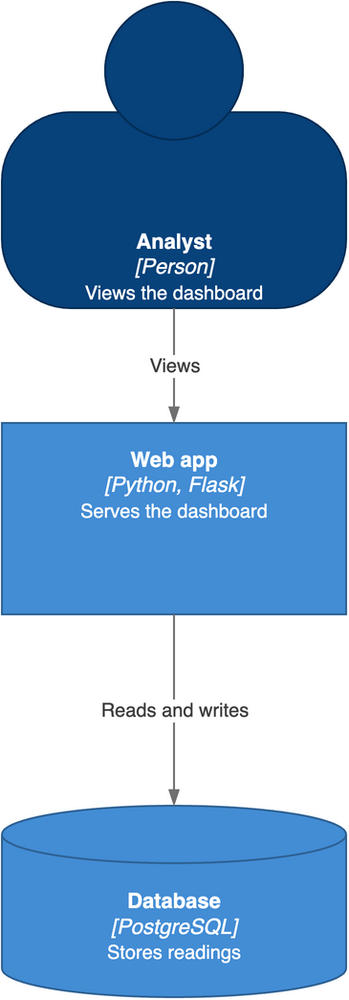

# diagram-lint

Agent skill for creating professional looking Mermaid and draw.io software and cloud architecture diagrams as code, with built in layout linting and consistency checks.

Use it to enable agents to generate professional looking diagrams that live in version control, that can be used in architecural design documents.



## How it works

| Diagram | Source | Layout |
|---------|--------|--------|
| Topology, or anything with cloud icons or logos | Python script that generates a `.drawio` file | Pinned to exact coordinates |
| Sequence, logic flow or component | `.mmd` file | Chosen by Mermaid |

## What it checks

- **Layout (draw.io):** `check_layout.py` fails on a line through a node, a crossing
  without a valid line jump, two lines drawn on top of each other, or an anchor outside
  its node. It reports any route it cannot predict as `UNVERIFIED`.
- **Content (draw.io):** after a re-layout, `content_diff.py` confirms that the node
  labels, edges and boundary contents are unchanged.
- **Render inspection (both):** a checklist catches what the scripts cannot, such as
  labels on captions, blank icons and lines that touch.

## Install

Copy `skills/diagram-lint/` into your agent's skills directory. For Claude Code, that
is `.claude/skills/`.

You need Python 3.12 or later. To render diagrams, you also need
[draw.io desktop](https://github.com/jgraph/drawio-desktop/releases) and
[mermaid-cli](https://github.com/mermaid-js/mermaid-cli).

## Try the example

Check the layout:

```bash
make -C examples/diagrams check
```

Render the diagrams:

```bash
make -C examples/diagrams
```

## Development

```bash
ruff check . && mypy --strict skills/diagram-lint/scripts && pytest
```

## Licence

BSD 3-Clause. See `LICENSE`.
